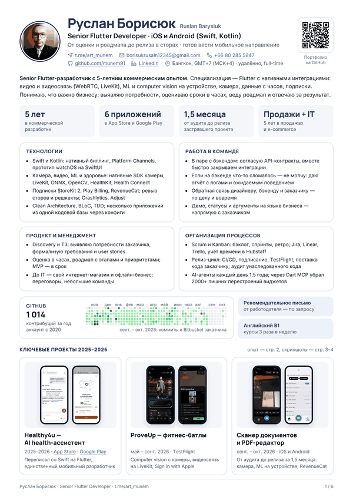
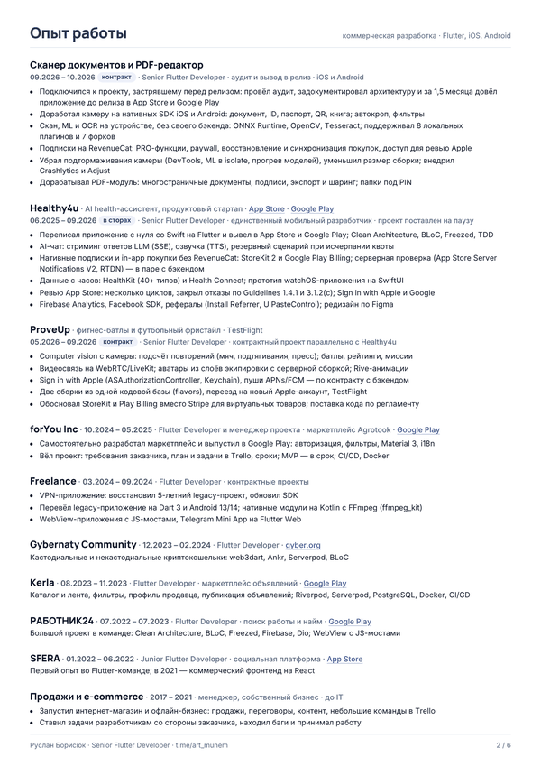
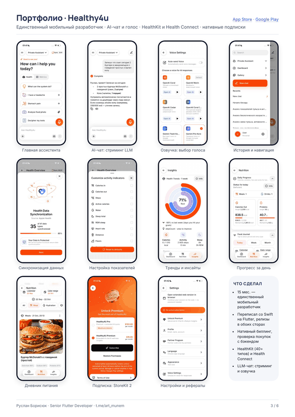
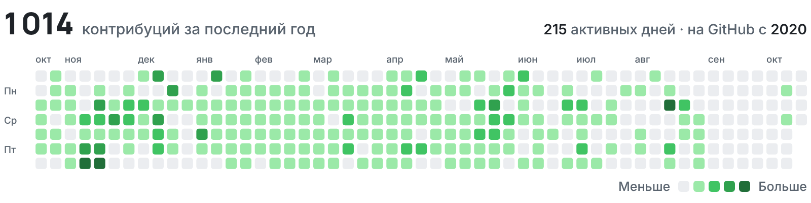

  

<h1 align="center">Руслан Борисюк · Ruslan Barysiuk</h1>

  <b>Senior Flutter Developer</b> · iOS и Android (Swift, Kotlin) · Бангкок, GMT+7, удалённо

  Довожу мобильные продукты от оценки и роадмапа до релиза в App Store и Google Play. 
  I take mobile products from estimates and roadmap to release on the App Store and Google Play.

<h3 align="center">
  <a href="https://munem91.github.io/barysiuk_ruslan_resume/">munem91.github.io/barysiuk_ruslan_resume</a>
</h3>

  Сайт-резюме: приложения, резюме на 10 языках в светлой и тёмной теме, контакты. 
  Отдельная страница на каждый язык: <a href="https://munem91.github.io/barysiuk_ruslan_resume/en.html">EN</a> · <a href="https://munem91.github.io/barysiuk_ruslan_resume/ru.html">RU</a> · <a href="https://munem91.github.io/barysiuk_ruslan_resume/uk.html">UKR</a> · <a href="https://munem91.github.io/barysiuk_ruslan_resume/be.html">BEL</a> · <a href="https://munem91.github.io/barysiuk_ruslan_resume/kk.html">KAZ</a> · <a href="https://munem91.github.io/barysiuk_ruslan_resume/es.html">ES</a> · <a href="https://munem91.github.io/barysiuk_ruslan_resume/fr.html">FR</a> · <a href="https://munem91.github.io/barysiuk_ruslan_resume/zh.html">ZH</a> · <a href="https://munem91.github.io/barysiuk_ruslan_resume/hi.html">HI</a> · <a href="https://munem91.github.io/barysiuk_ruslan_resume/ar.html">AR</a>, тёмная тема: <code>?theme=dark</code>

## Резюме

|             | PDF, светлая | PDF, тёмная | Для ATS, одна колонка |
| ----------- | ------------ | ----------- | --------------------- |
| **English** | [PDF](pdf/Barysiuk_Ruslan_Flutter_EN_Light.pdf) | [PDF](pdf/Barysiuk_Ruslan_Flutter_EN_Dark.pdf) | [DOCX](docx/Barysiuk_Ruslan_Flutter_ATS_EN.docx) |
| **Русский** | [PDF](pdf/Barysiuk_Ruslan_Flutter_RU_Light.pdf) | [PDF](pdf/Barysiuk_Ruslan_Flutter_RU_Dark.pdf) | [DOCX](docx/Barysiuk_Ruslan_Flutter_ATS_RU.docx) |
| **Українська** | [PDF](pdf/Barysiuk_Ruslan_Flutter_UKR_Light.pdf) | [PDF](pdf/Barysiuk_Ruslan_Flutter_UKR_Dark.pdf) | — |
| **Беларуская** | [PDF](pdf/Barysiuk_Ruslan_Flutter_BEL_Light.pdf) | [PDF](pdf/Barysiuk_Ruslan_Flutter_BEL_Dark.pdf) | — |
| **Қазақша** | [PDF](pdf/Barysiuk_Ruslan_Flutter_KAZ_Light.pdf) | [PDF](pdf/Barysiuk_Ruslan_Flutter_KAZ_Dark.pdf) | — |
| **Español** | [PDF](pdf/Barysiuk_Ruslan_Flutter_ES_Light.pdf) | [PDF](pdf/Barysiuk_Ruslan_Flutter_ES_Dark.pdf) | — |
| **Français** | [PDF](pdf/Barysiuk_Ruslan_Flutter_FR_Light.pdf) | [PDF](pdf/Barysiuk_Ruslan_Flutter_FR_Dark.pdf) | — |
| **中文** | [PDF](pdf/Barysiuk_Ruslan_Flutter_ZH_Light.pdf) | [PDF](pdf/Barysiuk_Ruslan_Flutter_ZH_Dark.pdf) | — |
| **हिन्दी** | [PDF](pdf/Barysiuk_Ruslan_Flutter_HI_Light.pdf) | [PDF](pdf/Barysiuk_Ruslan_Flutter_HI_Dark.pdf) | — |
| **العربية** | [PDF](pdf/Barysiuk_Ruslan_Flutter_AR_Light.pdf) | [PDF](pdf/Barysiuk_Ruslan_Flutter_AR_Dark.pdf) | — |

<table>
  <tr>
    <td width="33%">
      <a href="https://munem91.github.io/barysiuk_ruslan_resume/ru.html#page-1">
        <picture>
          <source media="(prefers-color-scheme: dark)" srcset="previews/ru-dark-1.png">
          
        </picture>
      </a>
    </td>
    <td width="33%">
      <a href="https://munem91.github.io/barysiuk_ruslan_resume/ru.html#page-2">
        <picture>
          <source media="(prefers-color-scheme: dark)" srcset="previews/ru-dark-2.png">
          
        </picture>
      </a>
    </td>
    <td width="33%">
      <a href="https://munem91.github.io/barysiuk_ruslan_resume/ru.html#page-3">
        <picture>
          <source media="(prefers-color-scheme: dark)" srcset="previews/ru-dark-3.png">
          
        </picture>
      </a>
    </td>
  </tr>
</table>

Ещё три страницы — ProveUp и сканер, проекты 2022–2025 и технический стек — на сайте и в PDF.

## Приложения

| Проект | Что это | Ссылки |
| ------ | ------- | ------ |
| **Healthy4u** | AI-ассистент здоровья · июнь 2025 — сентябрь 2026, переписал со Swift на Flutter, единственный мобильный разработчик 15 месяцев | [App Store](https://apps.apple.com/us/app/healthy4u-ai-health-assistant/id6742141790) · [Google Play](https://play.google.com/store/apps/details?id=world.healthy4u.mobile) |
| **ProveUp** | Фитнес-батлы и футбольный фристайл: computer vision, видеосвязь на LiveKit · май — сентябрь 2026 | TestFlight |
| **Сканер документов и PDF-редактор** | От аудита до релиза за 1,5 месяца: нативная камера, ML и OCR на устройстве · сентябрь — октябрь 2026 | — |
| **Agrotook** | Доска объявлений агрорынка | [Google Play](https://play.google.com/store/apps/details?id=app.agrotook) |
| **Kerla** | Маркетплейс объявлений | [Google Play](https://play.google.com/store/apps/details?id=com.ru.kerla) |
| **РАБОТНИК24** | Поиск работы и найм | [Google Play](https://play.google.com/store/apps/details?id=com.rabotnik24.mobile) |
| **SFERA** | Социальная платформа | [App Store](https://apps.apple.com/app/sfera-project/id1498046044) |
| **Gyber Wallet** | Криптокошелёк | [gyber.org](https://gyber.org) |

## Активность на GitHub

<picture>
  <source media="(prefers-color-scheme: dark)" srcset="previews/github-graph-dark.png">
  
</picture>

## Контакты

- **Telegram:** [@art_munem](https://t.me/art_munem) — удобнее всего
- **Email:** [borisukrusaln12345@gmail.com](mailto:borisukrusaln12345@gmail.com)
- **Телефон и WhatsApp:** [+66 80 285 5847](https://wa.me/66802855847)
- **LinkedIn:** [ruslan-barysiuk](https://www.linkedin.com/in/ruslan-barysiuk-005b27236/)
- **GitHub:** [munem91](https://github.com/munem91)

Full-time или part-time с почасовой оплатой · английский B1 · рекомендательное письмо от прошлого работодателя — по запросу. 
Сайт — чистый HTML, CSS и JS без сборки, хостинг GitHub Pages.
